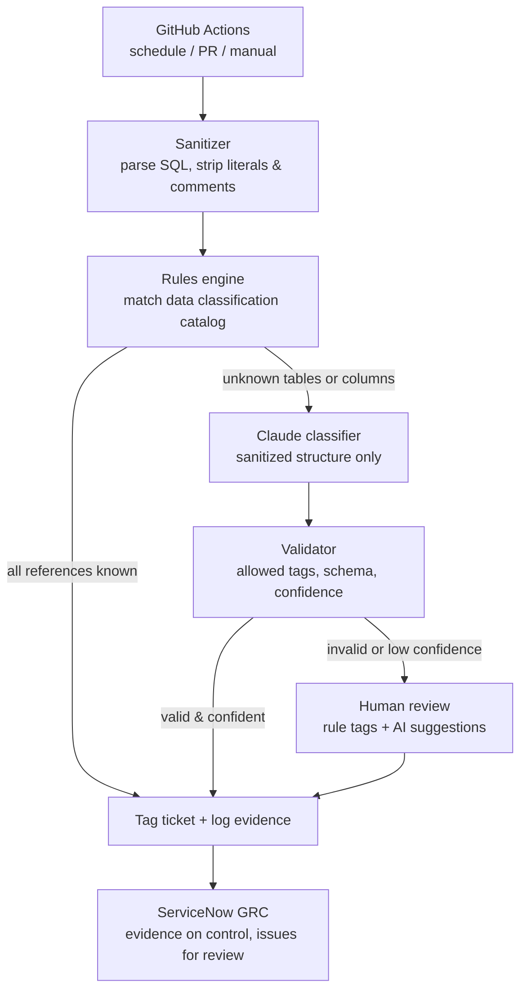

# GDPR SQL Tagger

A demo compliance automation pipeline that reviews SQL data requests for GDPR-relevant data use and tags the ticket automatically, using deterministic rules first and Claude only for the cases rules can't settle. Every decision is logged as audit evidence.

> All data in this repo is synthetic. This is a standalone demonstration of the pattern, not code from any employer.

## The problem

Analysts file tickets asking to run SQL against customer and merchant data. Someone has to check whether each query touches personal or restricted data and tag the ticket (for example *needs data-owner approval*). Done manually, that is slow, inconsistent, and hard to evidence for an audit.

## How it works



| Step | Module | What it does |
|---|---|---|
| Sanitize | `sanitizer.py` | Parses the SQL with `sqlglot`, replaces every literal with `?`, drops comments, then re-parses the output to prove nothing literal survived. Resolves aliases and subqueries to base tables. |
| Rules | `rules.py` | Looks up each `table.column` in `config/tag_catalog.yaml`. Expands `SELECT *`. Adds derived tags (e.g. any PII → `GDPR_PERSONAL_DATA`). |
| Classify | `classifier.py` | Only for unresolved references. Sends the sanitized query to Claude with a forced structured (tool-use) response. Backends: offline mock, Anthropic API, Amazon Bedrock. |
| Validate | `validator.py` | Rejects malformed output, drops any tag not in the allowed list, and routes low-confidence answers to a person. |
| GRC push | `servicenow.py` | Attaches evidence to the control record and opens issues for review items in ServiceNow GRC. |
| Tag + evidence | `integrations.py` | Writes tags and review status to the ticket and appends a timestamped evidence record. The raw SQL is never stored, only a SHA-256 hash for traceability. |

## Quick start

```bash
pip install -r requirements.txt
python -m gdpr_tagger            # offline mock classifier, no API key needed
pytest -q                        # 27 tests
```

Output on the sample tickets:

```
DATA-1001  auto_tagged_rules    GDPR_PERSONAL_DATA, GEO_REGION, PII_CONTACT, PSEUDONYMOUS_ID
DATA-1002  auto_tagged_rules    NO_PERSONAL_DATA
DATA-1003  auto_tagged_rules    GEO_REGION, MERCHANT_RESTRICTED, RESTRICTED_ACCESS_REVIEW
DATA-1004  auto_tagged_rules    GDPR_PERSONAL_DATA, GEO_REGION, PII_CONTACT, PII_IDENTITY, PII_LOCATION, PSEUDONYMOUS_ID
DATA-1005  auto_tagged_ai       GDPR_PERSONAL_DATA, PII_CONTACT
DATA-1006  needs_human_review   -  [suggested: PSEUDONYMOUS_ID]
DATA-1007  auto_tagged_rules    FINANCIAL, RESTRICTED_ACCESS_REVIEW
DATA-1008  auto_tagged_rules    GDPR_PERSONAL_DATA, GEO_REGION, PSEUDONYMOUS_ID
DATA-1009  needs_human_review   -
DATA-1010  auto_tagged_rules    NO_PERSONAL_DATA

Processed 10/10 tickets (complete=True): {'auto_tagged_rules': 7, 'auto_tagged_ai': 1, 'needs_human_review': 2}
```

What sanitization does to ticket DATA-1001:

```sql
-- before
SELECT c.email, o.total FROM customers c JOIN orders o ON c.id = o.customer_id
WHERE c.email = 'jane.doe@example.com' AND o.shipping_region = 'EU' -- check Jane's orders

-- after (the only form the model or the evidence log ever sees)
SELECT c.email, o.total FROM customers AS c JOIN orders AS o ON c.id = o.customer_id
WHERE c.email = ? AND o.shipping_region = ?
```

## Using real Claude

**Anthropic API**

```bash
export ANTHROPIC_API_KEY=...
export ANTHROPIC_MODEL=claude-haiku-5-5   # optional
python -m gdpr_tagger --classifier anthropic
```

**Amazon Bedrock** (the model runs inside AWS; per AWS documentation, model providers have no access to Bedrock prompts or completions)

```bash
export AWS_REGION=us-east-1
export BEDROCK_MODEL_ID=<Claude model or inference profile ID enabled in your account>
python -m gdpr_tagger --classifier bedrock
```

Tune the auto-tag cut-off with `--threshold` (default `0.8`).

## ServiceNow GRC

Each run can push its results into ServiceNow GRC (Policy and Compliance):

- The evidence file and run summary are **attached to the GRC control** the pipeline supports (`sn_compliance_control`), so the control carries continuous evidence for every run.
- Every ticket that needs human review becomes a **GRC issue** (`sn_grc_issue`) with the reason, rule tags, AI suggestions, and the *sanitized* query. Re-runs check for an open issue first, so nothing is duplicated.

```bash
python -m gdpr_tagger --servicenow dry-run   # writes output/servicenow_requests.json, calls nothing

export SN_INSTANCE_URL=https://yourcompany.service-now.com
export SN_CONTROL_SYS_ID=<sys_id of the control record>
export SN_USER=... SN_PASSWORD=...
export SN_ISSUE_FIELDS='{"assignment_group": "<group sys_id>"}'   # optional extra fields
python -m gdpr_tagger --servicenow live
```

Table names default to ServiceNow's standard GRC tables and can be overridden with `SN_CONTROL_TABLE` and `SN_ISSUE_TABLE`. Data models vary by instance and version, so confirm table and field names with your ServiceNow admin and use a least-privilege integration account.

## GitHub Actions

`.github/workflows/gdpr-tagging.yml` runs the tests, then the pipeline, on a weekday schedule, on pull requests, and on demand. The tagging job only runs if tests pass. Each run publishes a summary and uploads the evidence folder as a build artifact.

- Anthropic backend: add an `ANTHROPIC_API_KEY` repository secret.
- Bedrock backend: set repository variables `AWS_ROLE_ARN` and `BEDROCK_MODEL_ID`. The workflow assumes the role through OIDC, so no long-lived AWS keys are stored.
- ServiceNow: runs in `dry-run` by default. For `live`, set variables `SN_INSTANCE_URL` and `SN_CONTROL_SYS_ID` and secrets `SN_USER` and `SN_PASSWORD`.

## Design decisions

- **Data minimization before AI.** A query can itself contain personal data (`WHERE email = '...'`), so literals and comments are removed before anything leaves the parser. A test proves no literal from any sample ticket reaches the classifier or the evidence log.
- **Rules first, AI second.** Most tickets are settled by the catalog, which is fast, free, and easy for an auditor to re-perform. The model handles only what rules can't.
- **The model can't invent outcomes.** Structured output, an allowed-tag list, and a confidence threshold. Anything else goes to a person, with the model's suggestions attached.
- **Never blocked by the model.** If the API fails, rule tags still apply and the ticket goes to review.
- **Evidence an auditor can trust.** Each run records the code version (`GITHUB_SHA`), the catalog hash, the threshold, and the population count, and flags whether every ticket in the source was processed.

## Framework mapping

| Control idea | Where it shows up |
|---|---|
| GDPR Art. 25 data protection by design, ISO/IEC 27701 | Sanitizer, data classification catalog |
| ISO/IEC 42001 human oversight and AI output controls | Validator, human review route |
| SOC 2 CC8.1 / ISO 27001 A.8.32 change management | Workflow changes via PR, tests gate the run |
| SOC 2 CC7.2 / ISO 27001 A.8.15 logging | Evidence JSONL and run summary |
| Audit completeness and accuracy (IPE) | Population counts, hashes, version and config fingerprints |

## Project layout

```
gdpr_tagger/
  sanitizer.py      parse SQL, strip literals, resolve tables
  rules.py          catalog lookup and derived tags
  classifier.py     mock / Anthropic / Bedrock backends
  validator.py      guardrails on model output
  integrations.py   ticket store and evidence log
  servicenow.py     ServiceNow GRC evidence and issue push
  pipeline.py       orchestration and CLI
config/tag_catalog.yaml
data/tickets.json   synthetic tickets
tests/
.github/workflows/gdpr-tagging.yml
```

## Extending it

- Swap `LocalTicketStore` for a Jira client with the same `load` / `apply` methods.
- Post pass/fail results to GRC indicators for continuous control monitoring.
- Send evidence to write-once storage (for example S3 with Object Lock).
- Pass `dialect=` to the sanitizer for Redshift, Snowflake, BigQuery, etc.
